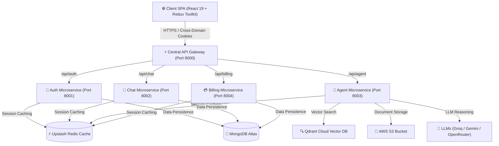

<div align="center">

  # 🤖 CortexAI — Production-Grade Microservices Multi-Agent System

  <p align="center">
    <b>A Enterprise-Ready Decoupled Microservices Platform Powering Autonomous Multimodal AI Agents</b>
  </p>

  [](https://github.com/mayanktrivedi05/MultiAGent-System)
  [](https://nodejs.org/)
  [](https://upstash.com/)
  [](https://www.langchain.com/)
  [](https://react.dev/)
  [](LICENSE)

</div>

---

## 🌟 Architecture Overview

**CortexAI** is an advanced, enterprise-grade AI Platform designed with a decoupled **Event-Driven Microservices Architecture**. 

Instead of relying on a monolithic backend, CortexAI distributes core business capabilities across an **API Gateway** and **4 independent Microservices** (`Auth`, `Chat`, `Agent`, `Billing`). This ensures high scalability, fault tolerance, low latency session recovery using **Redis**, and specialized vector-augmented generation via **Qdrant Vector Database**.

---

## 🏗️ System Architecture & Microservices Breakdown



### 🧩 Microservices Directory & Responsibilities

| Service | Port | Primary Responsibility | Key Technologies |
| :--- | :--- | :--- | :--- |
| **API Gateway** | `8000` | Reverse Proxy Routing, CORS Preflight, Auth Guards, Rate Limiting | Express, Express HTTP Proxy, Cookie-Parser |
| **Auth Service** | `8001` | Firebase Token Verification, User Sessions, Credit Deduction | Firebase Admin SDK, Redis, Mongoose |
| **Chat Service** | `8002` | Conversation Management, Message History Persistence | MongoDB Atlas, Mongoose |
| **AI Agent Service** | `8003` | LangGraph Autonomous Execution, RAG Pipeline, Vision Reasoning | LangGraph, Qdrant, Tavily, AWS S3 |
| **Billing Service** | `8004` | Order Generation, Subscription Webhooks, Payment Verification | Razorpay API, Mongoose |

---

## 🔥 Specialized Autonomous AI Agents

1. **👁️ Vision Reasoning Agent:** Optical object detection, diagram analysis, and image reasoning powered by Vision LLMs.
2. **📄 PDF RAG Agent:** Semantic Retrieval-Augmented Generation over uploaded PDF documents using **Qdrant Vector DB** and embeddings.
3. **🌐 Internet Search Agent:** Real-time web search grounding and live source citation using **Tavily Search API**.
4. **📊 PPT Deck Generator Agent:** Automated presentation structure and slide deck generation from natural language prompts.
5. **💻 Autonomous Coding Assistant:** Multi-language code generation, refactoring, and automated debugging.

---

## 🛠️ Tech Stack & Engineering Specifications

- **Frontend:** React 19, Vite, Redux Toolkit, TailwindCSS, Lucide Icons, Framer Motion
- **Microservices Engine:** Node.js, Express.js, Express-HTTP-Proxy
- **Database & Cache Layer:** MongoDB Atlas (Persistent Store), Upstash Redis (Session & State Cache), Qdrant Cloud (Vector DB)
- **AI Infrastructure:** LangChain, LangGraph StateGraph, Google Gemini AI, Groq (Llama 3), OpenRouter API, Tavily Web Search
- **Storage & Security:** AWS S3 (AWS SDK v3), Firebase Admin Auth, Razorpay Payment Gateway
- **DevOps & Orchestration:** Docker, Docker Compose, Nginx

---

## 🐳 Quick Start (Local Multi-Container Setup)

### Prerequisites
- [Node.js v18+](https://nodejs.org/)
- [Docker & Docker Compose](https://www.docker.com/)

### 1. Clone Repository & Setup Environment
```bash
git clone https://github.com/mayanktrivedi05/MultiAGent-System.git
cd MultiAGent-System
cp backend/.env.example backend/.env
```

### 2. Launch All Microservices with Docker Compose
Run the multi-container orchestration with a single command:
```bash
docker compose up -d --build
```

Verify all running container instances:
```bash
docker compose ps
```

### 3. Launch Frontend Client
```bash
cd frontend
npm install
npm run dev
```
Open [http://localhost:5173](http://localhost:5173) in your browser.

---

## 🔐 Environment Variables Configuration

Create a `.env` file inside `backend/` with the following schema:

```env
PORT=8000
MONGODB_URL=mongodb+srv://<username>:<password>@cluster.mongodb.net/cortexai
REDIS_URL=redis://localhost:6379
FRONTEND_URL=http://localhost:5173

# AI & LLM Providers
GROQ_API_KEY=gsk_...
GOOGLE_API_KEY=AQ...
TAVILY_API_KEY=tvly-...
OPENROUTER_API_KEY=sk-or-v1-...
QDRANT_API_KEY=eyJhbGci...
QDRANT_URL=https://<cluster-id>.qdrant.io

# Cloud Storage
AWS_REGION=ap-southeast-2
AWS_ACCESS_KEY_ID=AKIA...
AWS_SECRET_KEY=...
AWS_BUCKET_NAME=cortex-ai-agent

# Payments & Auth
RAZORPAY_KEY_ID=rzp_test_...
RAZORPAY_KEY_SECRET=...
```

---

## 🤝 Contributing & License

Contributions, issues, and feature requests are welcome! Feel free to check the [issues page](https://github.com/mayanktrivedi05/MultiAGent-System/issues).

Distributed under the MIT License. See `LICENSE` for more information.

<div align="center">
  Crafted with ❤️ by <b>Mayank Trivedi</b>
</div>
